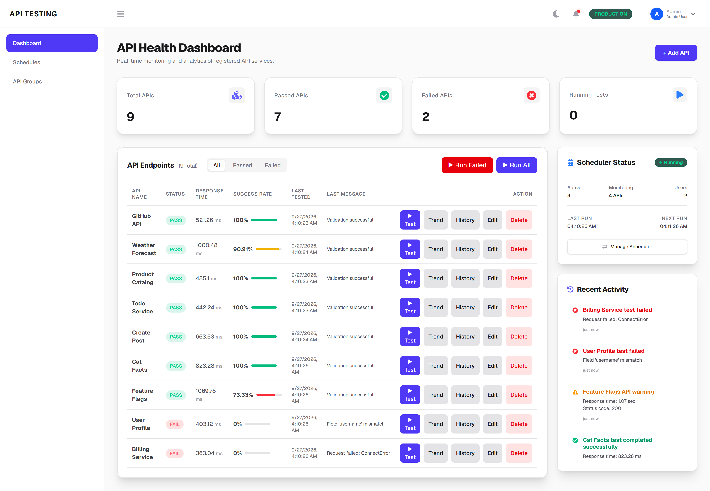
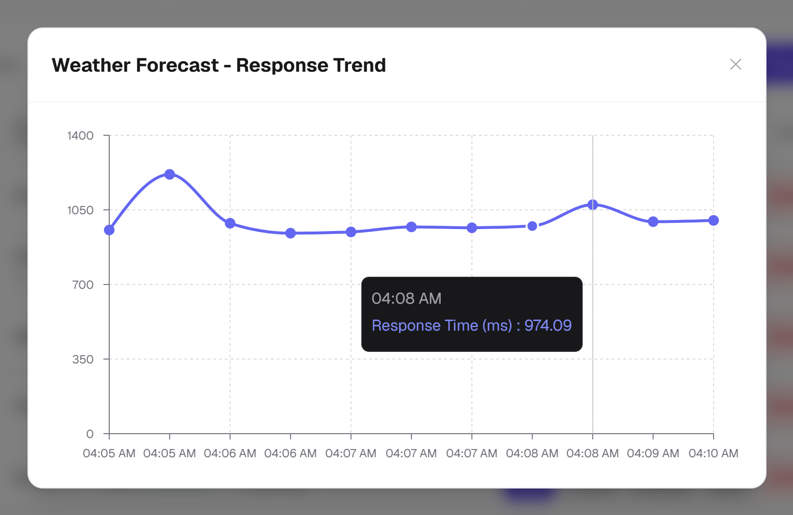
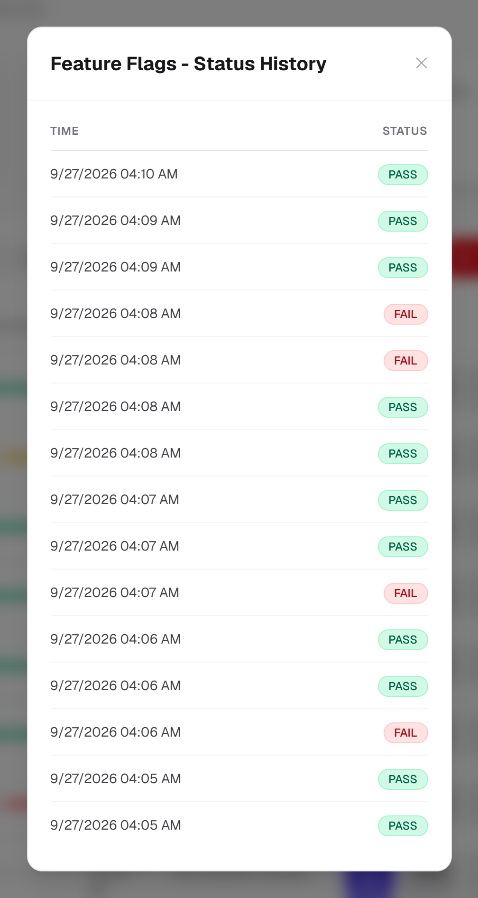
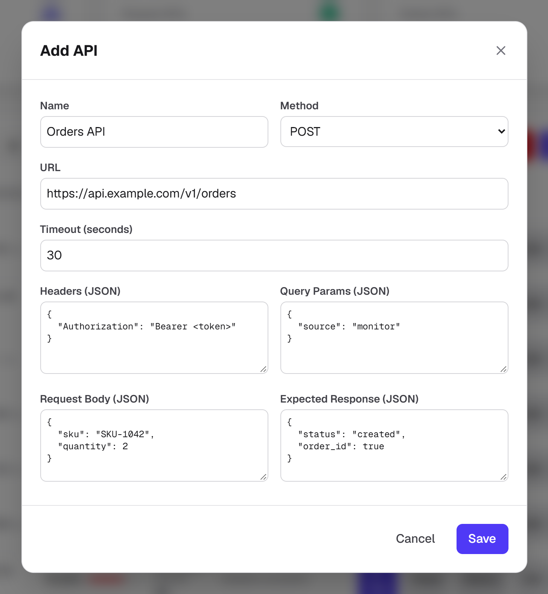
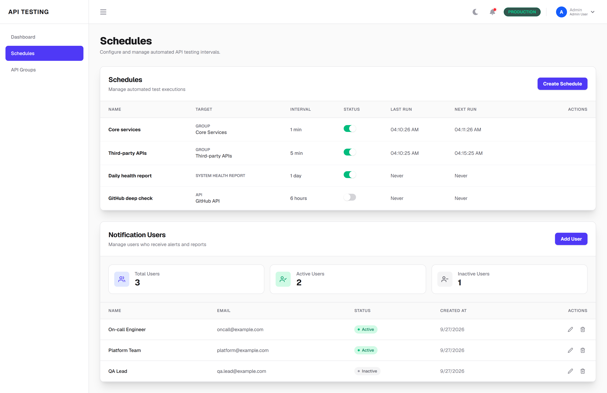
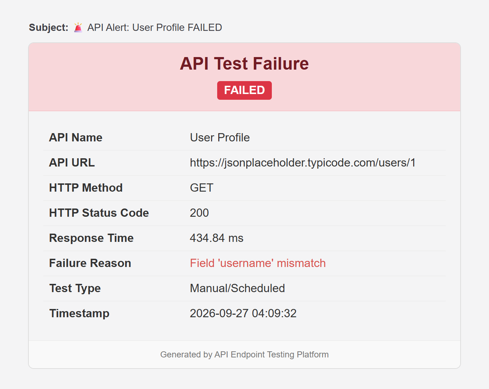
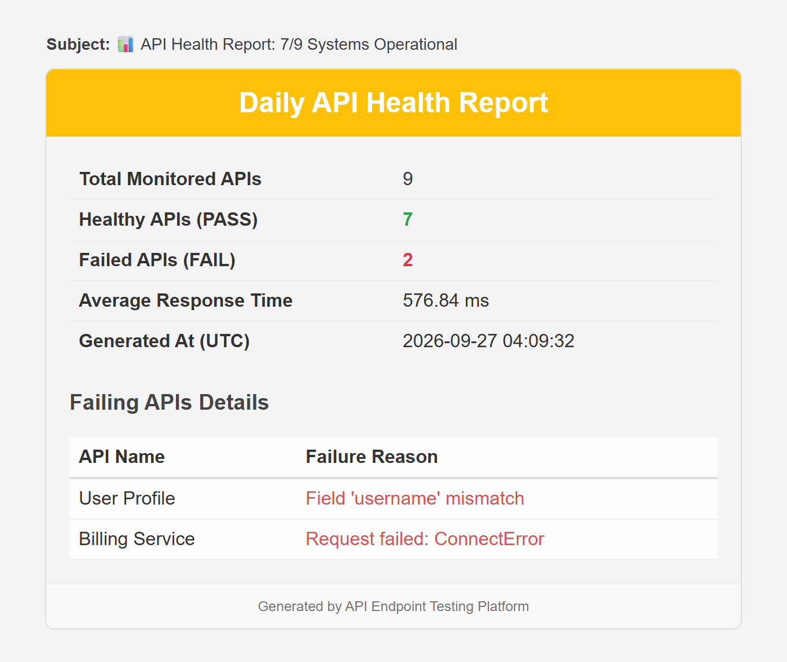
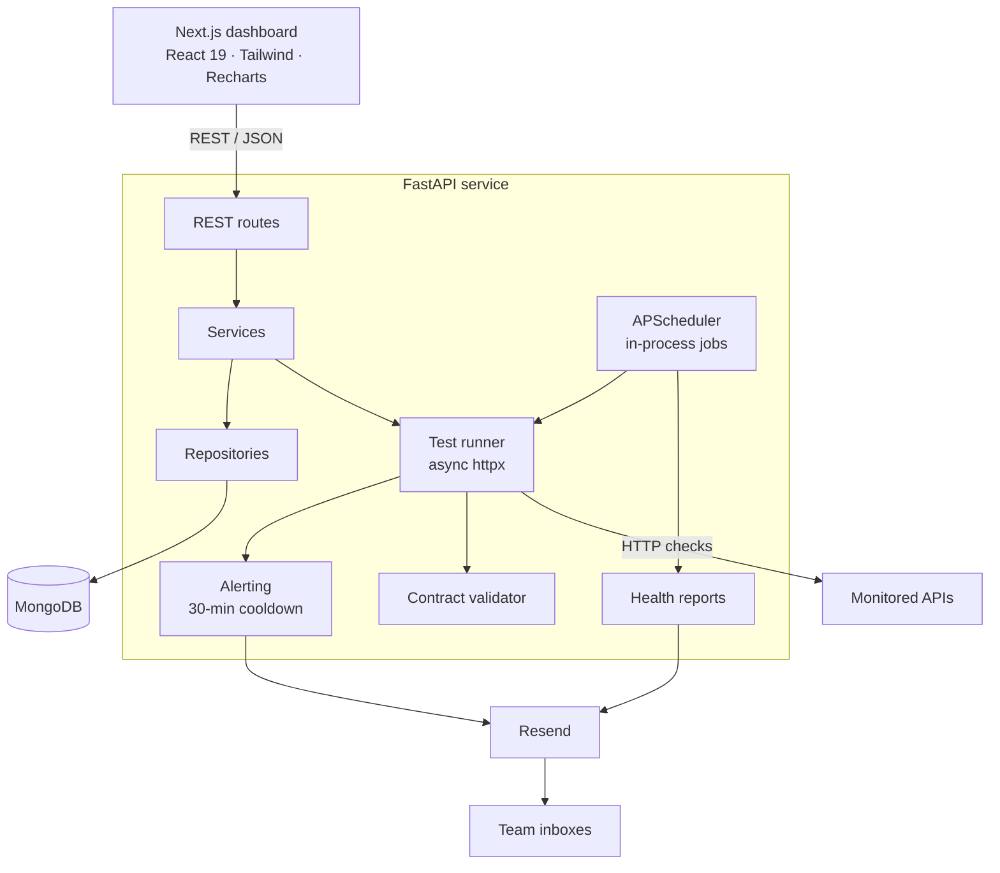
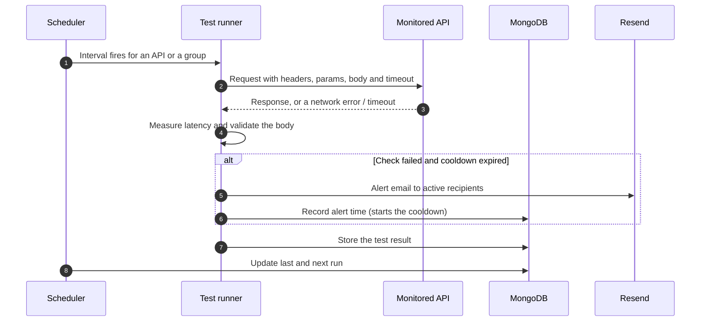

<div align="center">

# API Endpoint Testing

**Monitor the APIs your product depends on. Validate every response against a contract, run checks on a schedule, and alert the right people the moment something breaks.**

[](https://github.com/mdfaiz04/Api_Endpoint_Testing/actions/workflows/ci.yml)


[Features](#features) • [Screenshots](#screenshots) • [Architecture](#architecture) • [Quick start](#quick-start) • [API](#api-reference) • [Testing](#testing--ci) • [Roadmap](#roadmap)

</div>

<picture>
  <source media="(prefers-color-scheme: dark)" srcset="docs/screenshots/dashboard-dark.png">
  
</picture>

## Overview

A `200 OK` does not mean an API is healthy. Services go down, time out, or quietly change the shape of their responses and break every consumer downstream.

**API Endpoint Testing** is a full-stack synthetic-monitoring platform that catches all three. Register an endpoint once, with its URL, method, headers, query parameters, body and the fields a healthy response must contain. The platform then tests it on demand or on a schedule, records every result, charts latency and success rate over time, and emails your team when something fails, without flooding their inbox.

## Features

**Testing and validation**

- **Endpoint registry**: URL, method, headers, query parameters, JSON body and a per-endpoint timeout.
- **Response contract validation**: require fields to exist or to equal exact values, nested objects included. A `200 OK` with the wrong body is still a failure.
- **Outage detection**: DNS failures, refused connections and timeouts are recorded as failed tests with a reason, never silently dropped.
- **On-demand runs**: test one endpoint, all of them, or re-run only the ones that are currently failing.

**Automation**

- **Scheduler**: interval jobs from seconds to days that target a single API, an API group or the health report. Changes apply instantly without a restart, and last and next run times are persisted.
- **API groups**: organise endpoints (for example *Core Services* or *Third-party APIs*) and schedule them as one unit.

**Alerting and reporting**

- **Failure alerts**: HTML emails through [Resend](https://resend.com) to every active recipient.
- **Alert-storm protection**: a 30-minute cooldown per API. It starts only after an alert is actually delivered, so a failed send never silences the next one.
- **Health reports**: a scheduled digest with healthy and failing counts, average latency and failure reasons, colour-coded by severity.
- **Recipient management**: add, pause or remove the people who get notified.

**Dashboard**

- KPI cards plus per-endpoint status, latency, success rate and last result, filterable by pass or fail.
- Response-time trend chart and pass/fail history for the last 20 runs of each endpoint.
- Activity feed, scheduler status panel and toast notifications.
- Light and dark themes and a collapsible sidebar, remembered per browser.

## Screenshots

<table>
  <tr>
    <td width="50%" valign="top">
      <b>Response-time trend</b><br><br>
      <picture>
        <source media="(prefers-color-scheme: dark)" srcset="docs/screenshots/trend-dark.png">
        
      </picture>
    </td>
    <td width="50%" valign="top">
      <b>Pass/fail history of a flaky endpoint</b><br><br>
      <picture>
        <source media="(prefers-color-scheme: dark)" srcset="docs/screenshots/history-dark.png">
        
      </picture>
    </td>
  </tr>
  <tr>
    <td width="50%" valign="top">
      <b>Endpoint with a response contract</b><br><br>
      <picture>
        <source media="(prefers-color-scheme: dark)" srcset="docs/screenshots/add-endpoint-dark.png">
        
      </picture>
    </td>
    <td width="50%" valign="top">
      <b>Schedules and alert recipients</b><br><br>
      <picture>
        <source media="(prefers-color-scheme: dark)" srcset="docs/screenshots/schedules-dark.png">
        
      </picture>
    </td>
  </tr>
  <tr>
    <td width="50%" valign="top">
      <b>Failure alert email</b><br><br>
      
    </td>
    <td width="50%" valign="top">
      <b>Scheduled health report</b><br><br>
      
    </td>
  </tr>
</table>

<sub>All screenshots show real results against public APIs (GitHub, Open-Meteo, DummyJSON, JSONPlaceholder and others). Some endpoints misbehave on purpose: one has a drifted response contract, one points at an unreachable host and one flips between answers.</sub>

## Architecture



What happens on every scheduled check:



### Design decisions

- **Layered backend.** Routes call services, services call repositories. Business rules know nothing about HTTP or MongoDB, which is why the whole test suite runs in about a second without a database.
- **Contracts, not just status codes.** The validator checks the response body, so contract drift fails just like an outage does.
- **Failures are data.** Unreachable hosts and timeouts become failed test records with a reason, so they appear in history, success rates, alerts and reports.
- **Alerts that don't spam.** The per-API cooldown lives in MongoDB, so it survives restarts, and it is only recorded after a successful delivery.
- **Hot-reloaded schedules.** Every schedule change rebuilds the job set from the database. No restart needed.
- **One scheduler, one process.** Jobs run inside the API process, so the service runs as a single Uvicorn worker; more workers would duplicate every job. A dedicated worker service is on the roadmap.

### Response validation

`expected_response` is a JSON object of rules checked against the top-level fields of the response body:

| Rule | Passes when | Example |
| --- | --- | --- |
| `"field": true` | the field is present, with any value | `{"id": true}` |
| `"field": <value>` | the field equals the value exactly: strings, numbers, booleans, `null`, nested objects and arrays | `{"status": "ok", "meta": {"version": 2}}` |
| `{}` | always; only reachability and latency are tracked | `{}` |

Failures are reported as `Field 'x' missing`, `Field 'x' mismatch`, `Request timed out` or `Request failed: <error>`. Because `true` means "present", a field that must literally equal `true` can only be checked for presence.

## Tech stack

| Layer | Technologies |
| --- | --- |
| Frontend | Next.js 16 (App Router), React 19, TypeScript, Tailwind CSS 4, Recharts, Axios |
| Backend | Python, FastAPI, Pydantic v2, httpx (async), APScheduler, Uvicorn |
| Database | MongoDB with PyMongo |
| Notifications | Resend transactional email |
| Tooling | pytest, Ruff, Docker, Docker Compose, GitHub Actions |

## Project structure

```text
.
├── backend/
│   ├── app/
│   │   ├── main.py            # FastAPI app, CORS, lifespan (starts the scheduler)
│   │   ├── core/config.py     # Environment-driven settings
│   │   ├── database/          # MongoDB client and collections
│   │   ├── routes/            # HTTP layer, one router per resource
│   │   ├── services/          # Test runner, validator, scheduler, alerts, reports
│   │   ├── repositories/      # MongoDB data access
│   │   └── schemas/           # Pydantic models
│   ├── tests/                 # pytest suite (no database or network needed)
│   ├── Dockerfile
│   └── requirements.txt
├── frontend/
│   ├── app/                   # Routes: /dashboard, /dashboard/schedules, /dashboard/api-groups
│   ├── components/            # Dashboard, schedules and API group UI
│   ├── services/              # Typed API clients
│   ├── hooks/, types/
│   └── Dockerfile
├── docs/screenshots/
├── docker-compose.yml
└── .github/workflows/ci.yml
```

## Quick start

### Docker (recommended)

Requires Docker with Compose v2.

```bash
git clone https://github.com/mdfaiz04/Api_Endpoint_Testing.git
cd Api_Endpoint_Testing
docker compose up --build
```

| Service | URL |
| --- | --- |
| Dashboard | http://localhost:3000 |
| REST API | http://localhost:8000 |
| Interactive API docs | http://localhost:8000/docs |

To send real emails, copy `backend/.env.example` to `backend/.env` and set `RESEND_API_KEY` before starting. Without a key, alerts are logged instead of sent.

### Local development

Requires Python 3.12+, Node.js 20.9+ and MongoDB running on `localhost:27017`.

```bash
# Backend
cd backend
python -m venv .venv
source .venv/bin/activate          # Windows: .venv\Scripts\activate
pip install -r requirements.txt
cp .env.example .env               # optional
uvicorn app.main:app --reload
```

```bash
# Frontend, in a second terminal
cd frontend
npm ci
npm run dev
```

Then open http://localhost:3000.

### Try it

1. Click **+ Add API** and register `https://jsonplaceholder.typicode.com/todos/1` with the expected response `{"id": 1, "completed": false}`.
2. Press **▶ Test**. Status, latency and success rate update immediately.
3. Group endpoints under **API Groups**, then create a schedule under **Schedules**.
4. Add yourself under **Notification Users** to receive alerts and health reports.

## Configuration

The backend reads these settings from the environment or from `backend/.env` (see [`backend/.env.example`](backend/.env.example)):

| Variable | Default | Purpose |
| --- | --- | --- |
| `MONGO_URI` | `mongodb://localhost:27017` | MongoDB connection string |
| `DATABASE_NAME` | `api_endpoint_testing` | Database name |
| `CORS_ORIGINS` | `http://localhost:3000,http://127.0.0.1:3000` | Comma-separated origins allowed to call the API |
| `RESEND_API_KEY` | none | Enables email alerts and health reports |
| `RESEND_FROM_EMAIL` | `onboarding@resend.dev` | Sender address. Resend's test sender only delivers to your own account email; verify a domain to email anyone else. |
| `RESEND_TEST_RECIPIENT` | none | Recipient for `python -m app.services.resend_service`, a one-off delivery check |

The dashboard reads one variable (see [`frontend/.env.example`](frontend/.env.example)):

| Variable | Default | Purpose |
| --- | --- | --- |
| `NEXT_PUBLIC_API_BASE_URL` | `http://127.0.0.1:8000` | Backend URL, inlined at build time |

## API reference

Interactive OpenAPI docs are served at `/docs` (Swagger UI) and `/redoc`.

| Method | Path | Description |
| --- | --- | --- |
| `GET` | `/health` | Liveness check |
| `GET` `POST` | `/api-endpoints` | List or register endpoints |
| `PUT` `DELETE` | `/api-endpoints/{name}` | Update or delete an endpoint |
| `GET` | `/manual-test?name={name}` | Test one endpoint now |
| `GET` | `/manual-test-all` | Test every endpoint |
| `GET` | `/manual-test-failed` | Re-test endpoints whose latest run failed |
| `GET` | `/endpoint-summary` | Latest status, latency and success rate per endpoint |
| `GET` | `/dashboard-stats` | Totals, success rate and average latency |
| `GET` | `/test-logs` | Full test history |
| `GET` | `/response-time-history/{name}` | Last 20 latencies of an endpoint |
| `GET` | `/status-history/{name}` | Last 20 pass/fail results of an endpoint |
| `GET` | `/recent-activities` | Five most recent test runs |
| `GET` `POST` | `/api-groups` | List or create API groups |
| `PUT` `DELETE` | `/api-groups/{name}` | Update or delete a group |
| `GET` `POST` | `/scheduler-configs` | List or create schedules with an `API`, `GROUP` or `REPORT` target |
| `PUT` `DELETE` | `/scheduler-configs/{name}` | Update or delete a schedule; jobs reload instantly |
| `GET` | `/scheduler-jobs-debug` | Jobs currently registered in the scheduler |
| `GET` `POST` | `/api/v1/notification-recipients/` | List or add alert recipients |
| `GET` `PUT` `DELETE` | `/api/v1/notification-recipients/{id}` | Read, update or remove a recipient |

Register an endpoint and test it:

```bash
curl -X POST http://localhost:8000/api-endpoints \
  -H "Content-Type: application/json" \
  -d '{
        "name": "Todo Service",
        "url": "https://jsonplaceholder.typicode.com/todos/1",
        "method": "GET",
        "expected_response": {"id": 1, "completed": false}
      }'

curl "http://localhost:8000/manual-test?name=Todo%20Service"
```

```json
{
  "status_code": 200,
  "response_time_ms": 366.74,
  "passed": true,
  "message": "Validation successful",
  "actual_response": { "userId": 1, "id": 1, "title": "delectus aut autem", "completed": false }
}
```

## Testing & CI

```bash
cd backend
pip install -r requirements-dev.txt
pytest
```

53 tests run in about 1.5 seconds without a database, network access or an email provider: repositories, outbound HTTP (through `httpx.MockTransport`) and Resend are replaced with fakes. They cover:

- contract validation rules and failure messages
- the test runner: headers, query parameters and JSON bodies, non-JSON responses, timeouts and unreachable hosts
- the alert cooldown: suppression window, naive MongoDB timestamps and failed deliveries
- health-report aggregation and severity colours
- dashboard and per-endpoint metrics
- scheduler job registration, hot reload, and group and report execution
- the HTTP layer: validation errors, 404s and CORS
- environment-driven configuration

[GitHub Actions](.github/workflows/ci.yml) runs on every push and pull request:

| Job | What it checks |
| --- | --- |
| Backend | Ruff and pytest on Python 3.12 and 3.13 |
| Frontend | TypeScript type-check and a production build |
| Docker | Builds both images, starts the stack with Compose, then registers an endpoint and runs a live check end to end |

## Roadmap

- [ ] Send `PUT`, `PATCH` and `DELETE` checks with their real method (the runner currently sends `GET`, or `POST` with a body)
- [ ] Richer assertions: JSONPath, JSON Schema, status-code and latency thresholds
- [ ] Slack, Microsoft Teams and webhook alert channels
- [ ] Authentication and role-based access for the dashboard
- [ ] Move scheduling into a dedicated worker service (`worker/`) so checks scale independently of the API
- [ ] Store every timestamp in UTC and render it in the viewer's time zone
- [ ] Uptime and latency percentiles over 7 and 30 days

## Author

**MD Faiz** · [@mdfaiz04](https://github.com/mdfaiz04)
